# BESS sweep results

Everything is relative. Market metrics are an index with the same arm's no-battery mean set to 100; effects are percent of that mean. Battery profit is per MW installed, as a yield: the percent of what 1 MW sold flat all day would earn at the no-battery mean price. Absolute values stay in results.csv and paired_effects.csv.

Days run continuously in 7-day episodes. Battery charge is never reset and carries no penalty, and every agent sees the previous day's prices. Frozen generators therefore react to the battery's effect on yesterday's prices, so paired effects include that immediate response. Evaluation discards one warm-up episode. Metrics are per day.

## Pretraining

Generators are trained alone first. Policy change is the mean absolute change of their deterministic bid schedule (actions in [-1, 1]) between the last two rounds.

| Seed | Policy change per round | Converged |
|---|---|---|
| 42 | 0.313, 0.279, 0.228, 0.248, 0.222, 0.161, 0.123, 0.176, 0.139, 0.154, 0.117, 0.162, 0.209, 0.168, 0.099, 0.107, 0.063, 0.077, 0.094 | True |
| 43 | 0.226, 0.248, 0.282, 0.235, 0.135, 0.114, 0.121, 0.198, 0.036, 0.099, 0.123, 0.135, 0.080, 0.097, 0.082, 0.132, 0.098, 0.068, 0.062 | True |
| 44 | 0.377, 0.190, 0.292, 0.241, 0.214, 0.169, 0.155, 0.199, 0.120, 0.163, 0.159, 0.167, 0.141, 0.078, 0.115, 0.093, 0.090, 0.081, 0.075 | True |
| 45 | 0.321, 0.201, 0.226, 0.252, 0.167, 0.120, 0.137, 0.108, 0.177, 0.160, 0.151, 0.103, 0.199, 0.159, 0.077, 0.105, 0.072, 0.077, 0.069 | True |
| 46 | 0.282, 0.291, 0.223, 0.286, 0.159, 0.181, 0.197, 0.163, 0.231, 0.144, 0.139, 0.088, 0.084, 0.101, 0.097, 0.057, 0.090, 0.057, 0.106 | True |
| 47 | 0.259, 0.316, 0.238, 0.161, 0.143, 0.187, 0.211, 0.168, 0.229, 0.172, 0.138, 0.179, 0.085, 0.093, 0.100, 0.175, 0.174, 0.142, 0.096 | True |
| 48 | 0.296, 0.308, 0.241, 0.203, 0.156, 0.102, 0.184, 0.220, 0.229, 0.313, 0.215, 0.152, 0.134, 0.090, 0.104, 0.088, 0.105, 0.068, 0.101 | True |
| 49 | 0.297, 0.199, 0.228, 0.235, 0.146, 0.197, 0.157, 0.152, 0.119, 0.171, 0.132, 0.117, 0.099, 0.133, 0.121, 0.068, 0.080, 0.058, 0.050 | True |
| 50 | 0.355, 0.272, 0.201, 0.258, 0.197, 0.215, 0.147, 0.243, 0.185, 0.140, 0.165, 0.122, 0.084, 0.111, 0.168, 0.094, 0.104, 0.086, 0.057 | True |
| 51 | 0.298, 0.280, 0.139, 0.166, 0.149, 0.146, 0.171, 0.217, 0.218, 0.121, 0.160, 0.140, 0.130, 0.082, 0.078, 0.097, 0.111, 0.095, 0.086 | True |

## Arm: frozen

Index (no battery = 100), mean over seeds (± std across seeds). Per-config values are averages over the evaluation demand episodes. Loss-of-load figures are in results.csv.

| Power (MW) | Duration (h) | Seeds | Mean price | Price std | Daily spread | Consumer cost | Gen profit | BESS profit per MW (%) | BESS cycles |
|---|---|---|---|---|---|---|---|---|---|
| none | – | 10 | 100.00 ± 3.53 | 100.00 ± 27.83 | 100.00 ± 37.40 | 100.00 ± 2.64 | 100.00 ± 5.74 | – | – |
| 5 | 1 | 10 | 100.09 ± 3.53 | 98.35 ± 29.02 | 97.78 ± 38.62 | 100.12 ± 2.61 | 100.07 ± 5.62 | 2.73 ± 2.31 | 1.77 ± 0.88 |
| 5 | 2 | 10 | 100.04 ± 3.55 | 99.17 ± 28.35 | 98.92 ± 37.96 | 100.06 ± 2.67 | 100.00 ± 5.70 | 2.95 ± 2.42 | 1.10 ± 0.60 |
| 5 | 4 | 10 | 100.04 ± 3.50 | 99.09 ± 28.52 | 98.75 ± 38.10 | 100.05 ± 2.59 | 99.98 ± 5.64 | 2.89 ± 2.27 | 0.49 ± 0.28 |
| 5 | 8 | 10 | 100.08 ± 3.52 | 98.34 ± 29.01 | 97.82 ± 38.59 | 100.11 ± 2.61 | 100.10 ± 5.60 | 2.92 ± 2.62 | 0.28 ± 0.17 |
| 10 | 1 | 10 | 100.03 ± 3.55 | 98.88 ± 28.59 | 98.48 ± 38.26 | 100.06 ± 2.68 | 100.08 ± 5.79 | 2.49 ± 1.94 | 2.16 ± 1.19 |
| 10 | 2 | 10 | 100.10 ± 3.56 | 98.27 ± 29.09 | 97.42 ± 39.16 | 100.13 ± 2.63 | 100.27 ± 5.54 | 2.81 ± 1.99 | 1.36 ± 0.73 |
| 10 | 4 | 10 | 100.15 ± 3.54 | 96.27 ± 31.18 | 95.12 ± 41.55 | 100.21 ± 2.56 | 100.44 ± 5.34 | 2.84 ± 2.38 | 0.75 ± 0.47 |
| 10 | 8 | 10 | 100.05 ± 3.55 | 98.47 ± 29.00 | 97.86 ± 38.95 | 100.09 ± 2.67 | 100.21 ± 5.64 | 2.76 ± 2.32 | 0.35 ± 0.23 |
| 25 | 1 | 10 | 100.01 ± 3.49 | 96.42 ± 30.63 | 95.74 ± 40.71 | 100.08 ± 2.56 | 100.43 ± 5.39 | 1.66 ± 1.77 | 1.75 ± 1.09 |
| 25 | 2 | 10 | 99.97 ± 3.43 | 96.09 ± 30.23 | 95.87 ± 40.67 | 100.07 ± 2.53 | 100.48 ± 5.34 | 1.87 ± 1.80 | 1.01 ± 0.64 |
| 25 | 4 | 10 | 100.00 ± 3.33 | 96.77 ± 29.09 | 96.63 ± 39.64 | 100.09 ± 2.52 | 100.49 ± 5.44 | 1.68 ± 1.59 | 0.49 ± 0.36 |
| 25 | 8 | 10 | 100.08 ± 3.46 | 94.86 ± 31.07 | 93.99 ± 42.09 | 100.14 ± 2.55 | 100.70 ± 5.36 | 1.91 ± 1.73 | 0.29 ± 0.19 |
| 50 | 1 | 10 | 99.82 ± 3.39 | 98.31 ± 29.00 | 98.47 ± 38.30 | 99.82 ± 2.57 | 99.90 ± 5.77 | 0.83 ± 0.89 | 0.88 ± 0.56 |
| 50 | 2 | 10 | 99.92 ± 3.44 | 98.33 ± 29.24 | 98.27 ± 38.83 | 99.97 ± 2.56 | 100.12 ± 5.50 | 0.78 ± 0.87 | 0.40 ± 0.34 |
| 50 | 4 | 10 | 99.86 ± 3.43 | 98.84 ± 28.76 | 99.06 ± 37.95 | 99.89 ± 2.60 | 99.84 ± 5.79 | 0.75 ± 0.89 | 0.20 ± 0.15 |
| 50 | 8 | 10 | 99.84 ± 3.33 | 97.19 ± 29.08 | 97.66 ± 38.63 | 99.89 ± 2.49 | 100.15 ± 5.39 | 0.83 ± 0.82 | 0.13 ± 0.09 |
| 75 | 1 | 10 | 99.89 ± 3.52 | 99.37 ± 28.20 | 99.38 ± 38.13 | 99.91 ± 2.60 | 99.89 ± 5.46 | 0.50 ± 0.62 | 0.42 ± 0.32 |
| 75 | 2 | 10 | 99.84 ± 3.45 | 99.50 ± 28.20 | 99.91 ± 37.44 | 99.86 ± 2.66 | 99.76 ± 5.94 | 0.47 ± 0.54 | 0.20 ± 0.18 |
| 75 | 4 | 10 | 99.77 ± 3.42 | 99.32 ± 28.20 | 99.70 ± 37.53 | 99.77 ± 2.63 | 99.81 ± 5.70 | 0.53 ± 0.57 | 0.13 ± 0.10 |
| 75 | 8 | 10 | 99.80 ± 3.45 | 99.50 ± 28.39 | 99.71 ± 37.53 | 99.80 ± 2.61 | 99.81 ± 5.68 | 0.51 ± 0.60 | 0.06 ± 0.06 |

### Paired effects (battery minus same-seed baseline)

Mean difference as percent of the no-battery mean, with a 95% bootstrap interval across seeds; * marks an interval that excludes zero.

| Power (MW) | Duration (h) | Seeds | Mean price | Price std | Daily spread | Consumer cost | Gen profit |
|---|---|---|---|---|---|---|---|
| 5 | 1 | 10 | +0.09% [-0.01, +0.22] | -1.65% [-3.93, -0.01] * | -2.22% [-4.84, -0.00] * | +0.12% [-0.01, +0.29] | +0.07% [-0.28, +0.46] |
| 5 | 2 | 10 | +0.04% [-0.02, +0.13] | -0.83% [-2.29, +0.00] | -1.08% [-2.66, -0.00] * | +0.06% [-0.02, +0.18] | -0.00% [-0.31, +0.39] |
| 5 | 4 | 10 | +0.04% [-0.03, +0.13] | -0.91% [-2.54, +0.01] | -1.25% [-3.21, +0.04] | +0.05% [-0.03, +0.17] | -0.02% [-0.29, +0.26] |
| 5 | 8 | 10 | +0.08% [-0.02, +0.21] | -1.66% [-3.92, -0.04] * | -2.18% [-4.76, -0.00] * | +0.11% [-0.01, +0.27] | +0.10% [-0.26, +0.56] |
| 10 | 1 | 10 | +0.03% [-0.08, +0.18] | -1.12% [-2.98, -0.00] * | -1.52% [-3.97, +0.00] | +0.06% [-0.06, +0.23] | +0.08% [-0.45, +0.68] |
| 10 | 2 | 10 | +0.10% [-0.00, +0.23] | -1.73% [-3.68, -0.29] * | -2.58% [-5.19, -0.45] * | +0.13% [+0.01, +0.29] * | +0.27% [-0.30, +0.88] |
| 10 | 4 | 10 | +0.15% [+0.01, +0.31] * | -3.73% [-7.44, -0.30] * | -4.88% [-9.72, -0.87] * | +0.21% [+0.02, +0.43] * | +0.44% [-0.19, +1.11] |
| 10 | 8 | 10 | +0.05% [-0.04, +0.18] | -1.53% [-3.49, -0.01] * | -2.14% [-4.88, -0.00] * | +0.09% [-0.01, +0.24] | +0.21% [-0.33, +0.80] |
| 25 | 1 | 10 | +0.01% [-0.14, +0.18] | -3.58% [-6.73, -0.76] * | -4.26% [-8.22, -0.87] * | +0.08% [-0.11, +0.30] | +0.43% [-0.57, +1.43] |
| 25 | 2 | 10 | -0.03% [-0.24, +0.18] | -3.91% [-7.08, -1.17] * | -4.13% [-8.10, -0.74] * | +0.07% [-0.16, +0.31] | +0.48% [-0.50, +1.46] |
| 25 | 4 | 10 | -0.00% [-0.21, +0.22] | -3.23% [-5.67, -1.12] * | -3.37% [-6.73, -0.62] * | +0.09% [-0.14, +0.33] | +0.49% [-0.24, +1.33] |
| 25 | 8 | 10 | +0.08% [-0.21, +0.45] | -5.14% [-11.19, -1.12] * | -6.01% [-14.05, -0.62] * | +0.14% [-0.13, +0.47] | +0.70% [-0.33, +1.84] |
| 50 | 1 | 10 | -0.18% [-0.40, +0.04] | -1.69% [-3.74, -0.32] * | -1.53% [-4.01, +0.00] | -0.18% [-0.43, +0.07] | -0.10% [-0.93, +0.61] |
| 50 | 2 | 10 | -0.08% [-0.22, +0.05] | -1.67% [-3.65, -0.13] * | -1.73% [-4.16, +0.02] | -0.03% [-0.17, +0.12] | +0.12% [-0.74, +0.82] |
| 50 | 4 | 10 | -0.14% [-0.33, +0.02] | -1.16% [-2.77, -0.10] * | -0.94% [-2.99, +0.16] | -0.11% [-0.31, +0.06] | -0.16% [-0.96, +0.47] |
| 50 | 8 | 10 | -0.16% [-0.39, +0.05] | -2.81% [-5.12, -0.83] * | -2.34% [-4.91, -0.29] * | -0.11% [-0.40, +0.13] | +0.15% [-0.67, +0.85] |
| 75 | 1 | 10 | -0.11% [-0.19, -0.03] * | -0.63% [-1.53, -0.06] * | -0.62% [-1.86, -0.00] * | -0.09% [-0.20, +0.01] | -0.11% [-0.96, +0.63] |
| 75 | 2 | 10 | -0.16% [-0.35, -0.02] * | -0.50% [-1.07, -0.09] * | -0.09% [-0.27, +0.00] | -0.14% [-0.33, -0.01] * | -0.24% [-0.92, +0.26] |
| 75 | 4 | 10 | -0.23% [-0.39, -0.09] * | -0.68% [-1.29, -0.20] * | -0.30% [-0.88, +0.00] | -0.23% [-0.41, -0.07] * | -0.19% [-0.94, +0.40] |
| 75 | 8 | 10 | -0.20% [-0.35, -0.07] * | -0.50% [-1.17, +0.08] | -0.29% [-0.87, +0.00] | -0.20% [-0.38, -0.05] * | -0.19% [-0.95, +0.42] |

### Batteries below 0.6 equivalent cycles (120 of 200)

p10_d2_s46, p10_d4_s42, p10_d4_s46, p10_d4_s47, p10_d4_s51, p10_d8_s42, p10_d8_s43, p10_d8_s46, p10_d8_s47, p10_d8_s48, p10_d8_s49, p10_d8_s51, p25_d1_s42, p25_d1_s46, p25_d1_s51, p25_d2_s42, p25_d2_s46, p25_d2_s51, p25_d4_s42, p25_d4_s43, p25_d4_s46, p25_d4_s47, p25_d4_s51, p25_d8_s42, p25_d8_s43, p25_d8_s44, p25_d8_s45, p25_d8_s46, p25_d8_s47, p25_d8_s48, p25_d8_s49, p25_d8_s50, p25_d8_s51, p50_d1_s42, p50_d1_s46, p50_d1_s51, p50_d2_s42, p50_d2_s46, p50_d2_s47, p50_d2_s48, p50_d2_s49, p50_d2_s50, p50_d2_s51, p50_d4_s42, p50_d4_s43, p50_d4_s44, p50_d4_s45, p50_d4_s46, p50_d4_s47, p50_d4_s48, p50_d4_s49, p50_d4_s50, p50_d4_s51, p50_d8_s42, p50_d8_s43, p50_d8_s44, p50_d8_s45, p50_d8_s46, p50_d8_s47, p50_d8_s48, p50_d8_s49, p50_d8_s50, p50_d8_s51, p5_d1_s46, p5_d1_s51, p5_d2_s42, p5_d2_s43, p5_d2_s46, p5_d4_s42, p5_d4_s43, p5_d4_s46, p5_d4_s47, p5_d4_s48, p5_d4_s49, p5_d4_s51, p5_d8_s42, p5_d8_s43, p5_d8_s44, p5_d8_s45, p5_d8_s46, p5_d8_s47, p5_d8_s48, p5_d8_s49, p5_d8_s51, p75_d1_s42, p75_d1_s43, p75_d1_s46, p75_d1_s48, p75_d1_s49, p75_d1_s51, p75_d2_s42, p75_d2_s43, p75_d2_s44, p75_d2_s45, p75_d2_s46, p75_d2_s47, p75_d2_s48, p75_d2_s49, p75_d2_s50, p75_d2_s51, p75_d4_s42, p75_d4_s43, p75_d4_s44, p75_d4_s45, p75_d4_s46, p75_d4_s47, p75_d4_s48, p75_d4_s49, p75_d4_s50, p75_d4_s51, p75_d8_s42, p75_d8_s43, p75_d8_s44, p75_d8_s45, p75_d8_s46, p75_d8_s47, p75_d8_s48, p75_d8_s49, p75_d8_s50, p75_d8_s51

### Paired effects excluding those batteries

| Power (MW) | Duration (h) | Seeds | Mean price | Price std | Daily spread | Consumer cost | Gen profit |
|---|---|---|---|---|---|---|---|
| 5 | 1 | 8 | +0.12% [-0.01, +0.27] | -2.20% [-5.11, -0.09] * | -3.04% [-6.59, +0.00] | +0.16% [-0.00, +0.35] | +0.18% [-0.23, +0.63] |
| 5 | 2 | 7 | +0.05% [-0.03, +0.18] | -1.17% [-3.18, -0.01] * | -1.56% [-3.85, -0.00] * | +0.09% [-0.03, +0.25] | +0.07% [-0.35, +0.62] |
| 5 | 4 | 3 | +0.00% [-0.07, +0.11] | -0.47% [-1.16, +0.01] | -1.20% [-3.83, +0.24] | +0.01% [-0.05, +0.15] | +0.04% [-0.11, +0.25] |
| 5 | 8 | 1 | +0.05% | -1.11% | -3.42% | +0.11% | +0.21% |
| 10 | 1 | 10 | +0.03% [-0.08, +0.18] | -1.12% [-2.98, -0.00] * | -1.52% [-3.97, +0.00] | +0.06% [-0.06, +0.23] | +0.08% [-0.45, +0.68] |
| 10 | 2 | 9 | +0.11% [+0.00, +0.25] * | -1.96% [-4.15, -0.34] * | -3.01% [-6.02, -0.68] * | +0.14% [+0.01, +0.32] * | +0.34% [-0.28, +0.98] |
| 10 | 4 | 6 | +0.26% [+0.05, +0.46] * | -6.28% [-11.93, -1.73] * | -8.46% [-15.34, -2.59] * | +0.36% [+0.07, +0.64] * | +0.88% [-0.12, +1.78] |
| 10 | 8 | 3 | -0.02% [-0.11, +0.12] | -2.32% [-5.84, +0.04] | -4.01% [-8.20, +0.00] | +0.05% [-0.04, +0.15] | +0.69% [+0.45, +0.87] * |
| 25 | 1 | 7 | +0.02% [-0.20, +0.26] | -5.28% [-9.22, -1.84] * | -6.59% [-11.81, -1.92] * | +0.12% [-0.16, +0.43] | +0.74% [-0.69, +2.02] |
| 25 | 2 | 7 | -0.05% [-0.33, +0.26] | -5.68% [-9.64, -2.19] * | -6.39% [-11.68, -1.52] * | +0.10% [-0.24, +0.44] | +0.80% [-0.60, +2.08] |
| 25 | 4 | 5 | -0.06% [-0.42, +0.32] | -4.33% [-7.21, -1.94] * | -4.31% [-8.67, -0.58] * | +0.08% [-0.34, +0.51] | +0.95% [-0.44, +2.35] |
| 50 | 1 | 7 | -0.25% [-0.53, +0.06] | -2.50% [-5.21, -0.54] * | -2.37% [-6.21, +0.00] | -0.25% [-0.58, +0.11] | -0.01% [-1.18, +0.99] |
| 50 | 2 | 3 | -0.16% [-0.54, +0.34] | -6.62% [-10.58, -1.49] * | -7.75% [-13.96, +0.14] | -0.03% [-0.51, +0.47] | +1.41% [+1.01, +2.06] * |
| 75 | 1 | 4 | -0.16% [-0.27, -0.00] * | -1.76% [-4.03, -0.49] * | -2.10% [-6.29, -0.00] * | -0.12% [-0.36, +0.11] | +0.51% [-0.26, +1.66] |

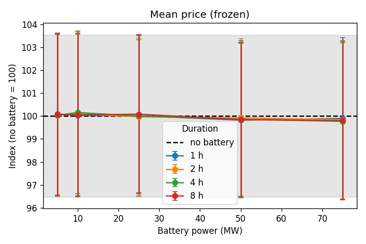
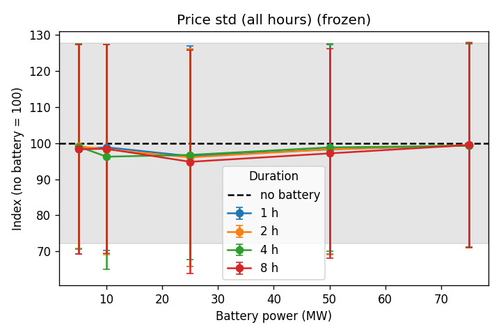
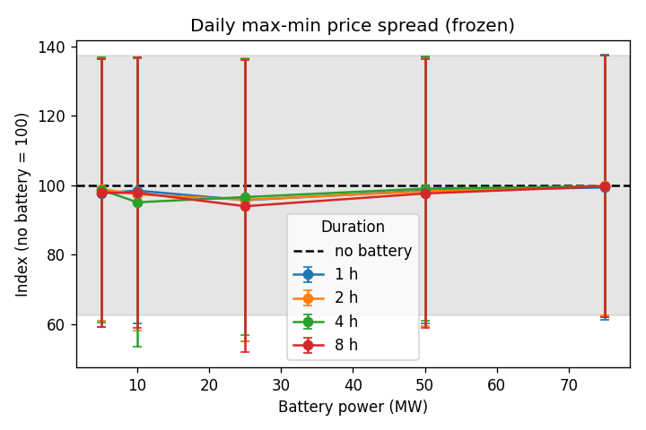
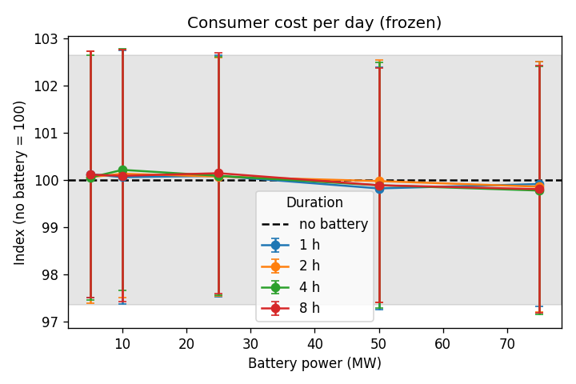
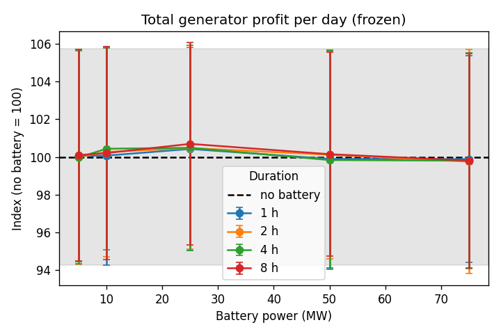
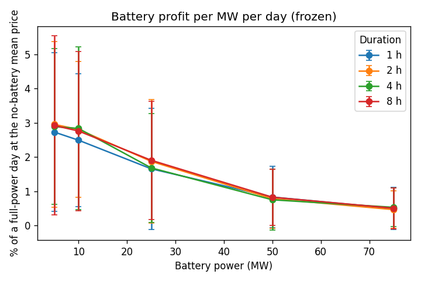
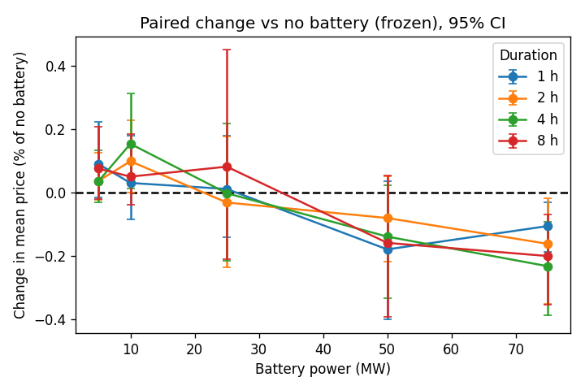
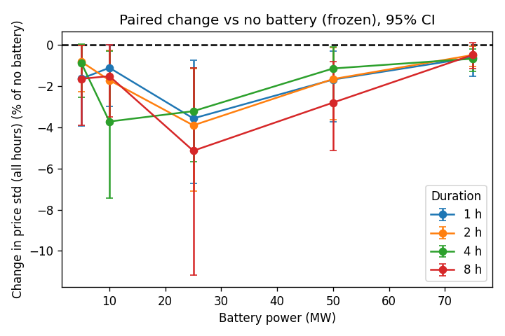
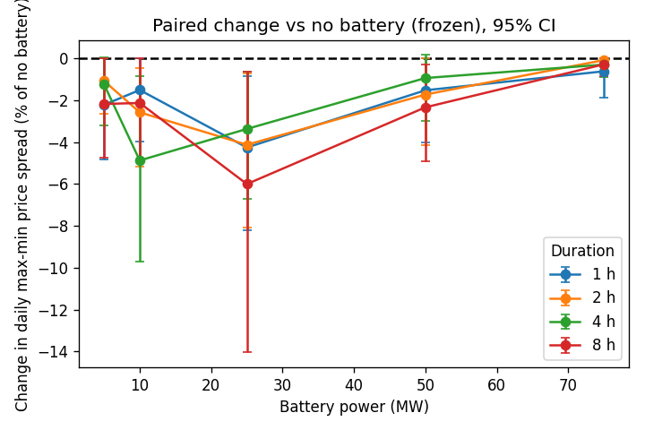
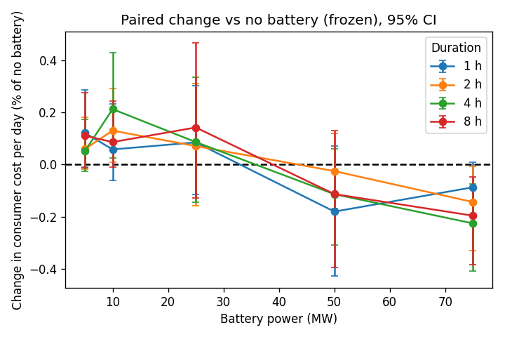
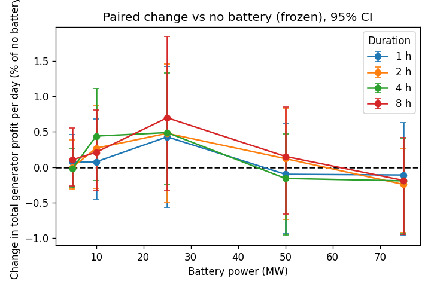

